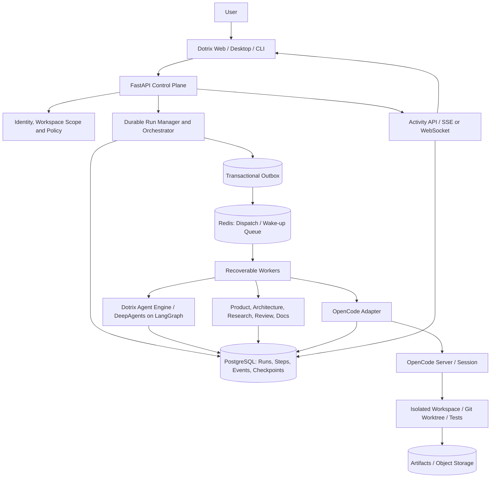
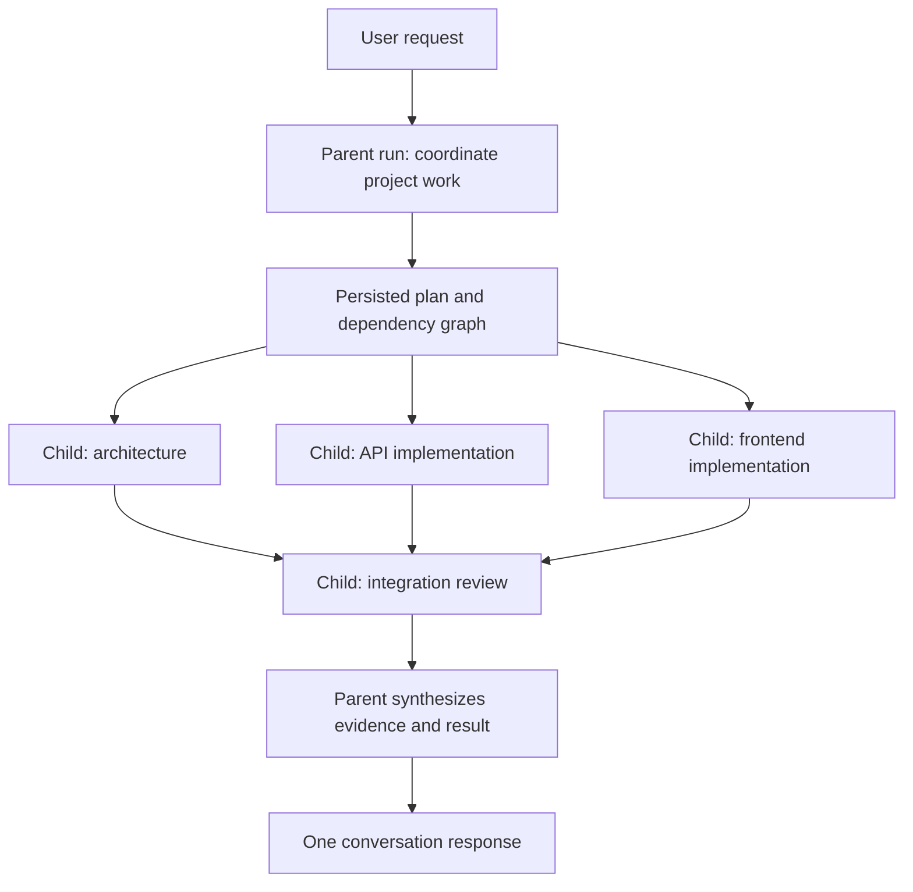
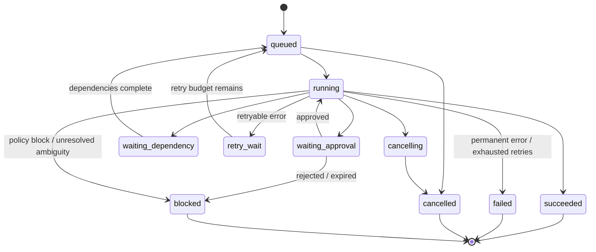
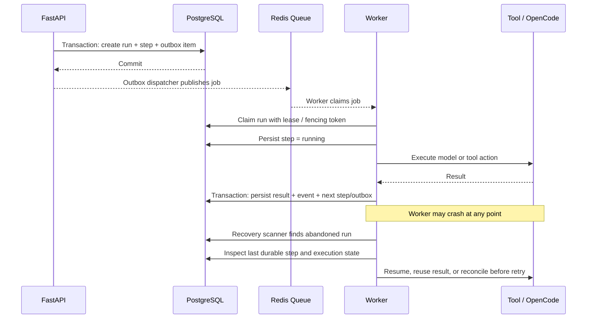
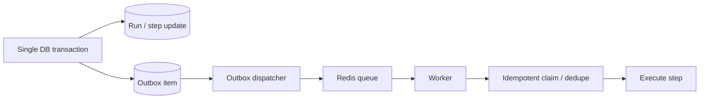
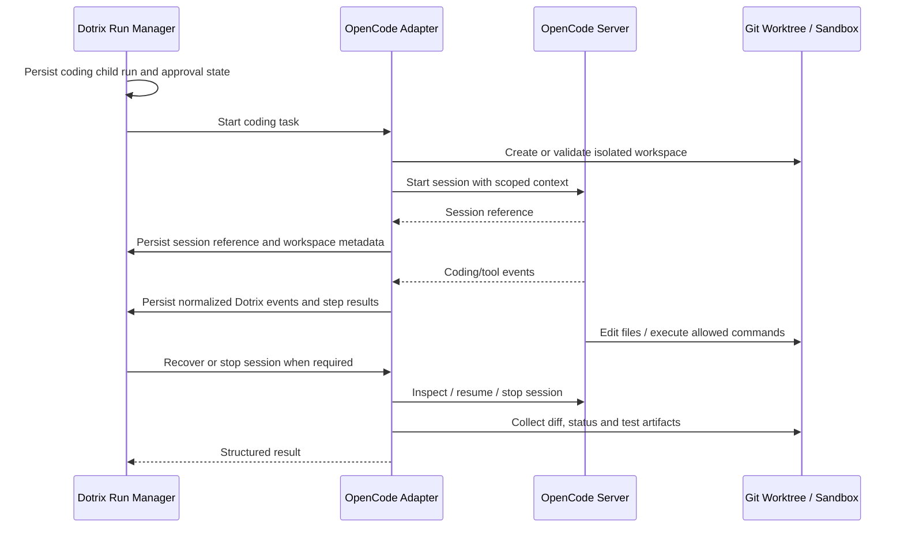
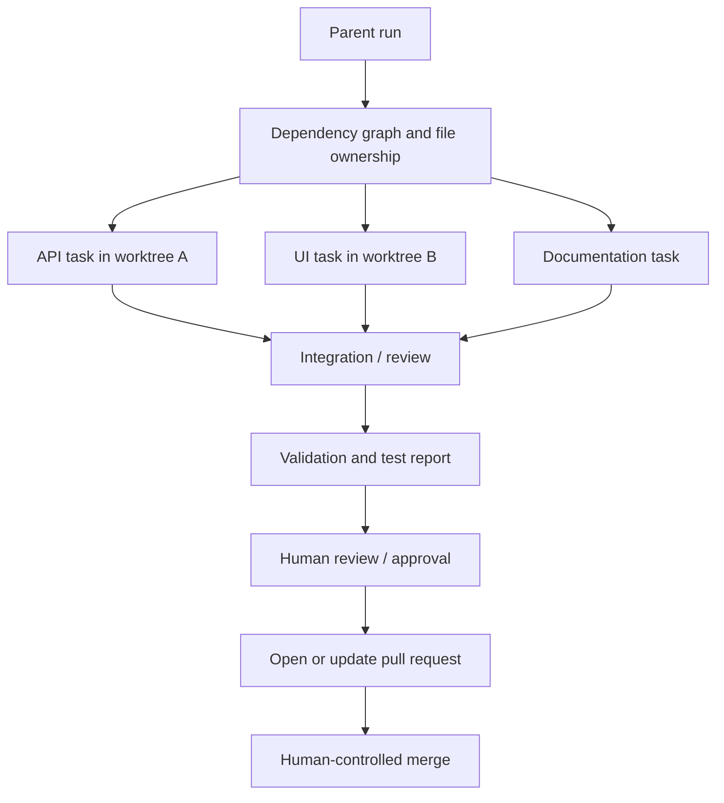
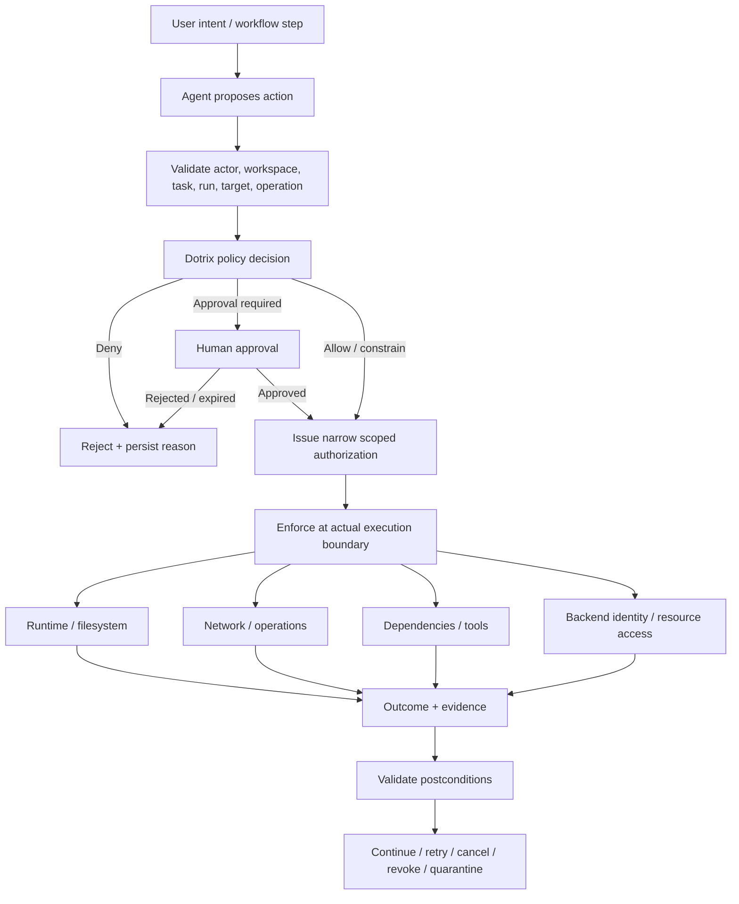

# Dotrix Durable Agent Harness

> Pilot status: project conversations can use the fixed Nova team and durable specialist
> batches behind `DOTRIX_DURABLE_DELEGATION`. The implemented scope and remaining limits are
> recorded in [nova-team.md](nova-team.md); this document also contains broader proposals.

## Product vision, architecture, design decisions and step-by-step implementation plan

**Status:** Proposed architecture\
**Date:** 21 October 2026\
**Scope:** Dotrix web, desktop and CLI; hidden specialist agents;
unified chat and coding; OpenCode integration; durable orchestration,
recovery and activity streaming.

------------------------------------------------------------------------

## 1. Executive summary

Dotrix should feel like **one intelligent project teammate**. A user can
discuss an idea, create a plan, delegate work, implement code and review
the outcome in one conversation. Behind that experience, Dotrix
coordinates built-in specialist agents and coding sessions, including
independent tasks that can run in parallel.

To make this dependable, Dotrix should own a **durable orchestration
harness**. A model response, worker process, browser connection or
coding session must not be the source of truth for whether work exists
or what has completed.

The harness is responsible for:

-   Persisting parent and child runs, step state, outputs, approvals and
    activity events.
-   Recovering work after process crashes and transient service
    failures.
-   Dispatching jobs reliably without losing work between a database
    write and queue publication.
-   Reusing completed results where safe and reconciling ambiguous side
    effects before retrying.
-   Coordinating specialist agents and OpenCode through replaceable
    adapters.
-   Preserving coding workspaces, Git branches/worktrees, test outputs
    and session references.
-   Streaming a persisted activity timeline to chat and catching up
    after reconnects.
-   Enforcing workspace isolation, least privilege, approval gates,
    auditability and resource limits.

**Recommendation:** Dotrix owns cross-agent orchestration durability,
policy enforcement and the run ledger. DeepAgents on LangGraph powers
chat, planning and specialist workflows; OpenCode is the selected coding
runtime behind a dedicated adapter. Evaluate Vercel's open-source
durable-harness for reusable OpenCode turn-level recovery before
reimplementing that part.

The [product roadmap](./dotrix-product-strategy-and-roadmap.md) carries
these principles into first-release scope and acceptance criteria. The
[Repository Knowledge skill](./dotrix-repository-knowledge-skill.md)
uses this same durable workflow and supplies versioned project context
to both chat and coding.

## 2. Product experience and principles

### 2.1 One conversation, multiple modes of work

The same thread supports:

1.  **Discuss** --- clarify the problem and explore options.
2.  **Plan** --- create a proposal, task breakdown and dependencies.
3.  **Build** --- execute explicitly requested tasks, run coding
    sessions and tests.
4.  **Review** --- present evidence, diffs, test results, risks and
    approval requests.

These are modes of work, not separate products. Asking "How would you
implement this?" should normally produce advice, not silently modify a
repository. Implementation starts when the user clearly requests changes
or approves a plan.

### 2.2 Built-in specialists are hidden by default

Dotrix has a primary coordinating agent and specialist agents such as
Product, Architecture, Research, Code Review and Documentation, with
OpenCode-backed coding execution. The coordinator and specialist
workflows use DeepAgents on LangGraph.

The user primarily talks to Dotrix. Specialists work behind the scenes
and appear in a compact, expandable activity timeline when useful. Show
meaningful actions, evidence, outcomes, errors, changes and
approvals---not private hidden chain-of-thought or unrestricted internal
transcripts.

The parent agent owns the user-facing response. Specialists return
structured findings, artifacts, risks and recommendations; the parent
reconciles them and explains the outcome.

### 2.3 Core principles

-   **Durability before scale:** prove one recoverable coding run before
    enabling broad parallelism.
-   **One source of truth:** Dotrix owns parent/child run state and
    permissions; OpenCode owns coding execution state exposed through
    its adapter.
-   **Human accountability:** sensitive actions require explicit
    approval or a narrowly scoped, owner-approved standing rule.
-   **Visible work, private reasoning:** expose activity and evidence,
    not hidden chain-of-thought.
-   **Runtime and provider neutrality:** models and coding engines are
    adapters, not the product's identity.
-   **Least privilege:** child agents cannot gain more authority than
    their initiating user or parent task.
-   **Recover, do not blindly restart:** use persisted progress,
    idempotency and reconciliation.
-   **Isolated execution:** coding tasks use per-run workspaces and
    resource boundaries.
-   **Auditable outcomes:** consequential actions record actor,
    timestamp, target and result.

## 3. High-level architecture



**Boundary rule:** PostgreSQL is the durable source of truth for Dotrix
orchestration. Redis is a dispatch and coordination mechanism, not the
only place a task's existence or progress is recorded. OpenCode session
data is useful execution state but does not replace Dotrix's
parent/child run ledger.

### 3.1 Component responsibilities

  ---------------------------------------------------------------------------
  Component               Owns                        Must not own
  ----------------------- --------------------------- -----------------------
  Web / desktop / CLI     Chat, activity, diffs,      Authoritative run state
                          approval UI and user
                          controls

  FastAPI control plane   Auth, workspace scope,      Long-running work
                          APIs, policy checks and run inside request
                          creation                    lifecycle

  Durable run manager     Run lifecycle, transitions, Provider-specific
                          retries, recovery and       prompts embedded in
                          cancellation                generic infrastructure

  Agent engine /          Agent graph, planning and   Cross-product
  LangGraph               specialist calls            authorization or the
                                                      only record of run
                                                      status

  Specialist adapters     Domain instructions, tools  Unrestricted privileges
                          and output schemas

  OpenCode adapter        Start/resume/inspect/stop   Parent orchestration or
                          coding sessions; map events approval policy
                          to Dotrix

  PostgreSQL              Durable ledger, events,     High-volume ephemeral
                          checkpoints, approvals and  fan-out
                          outbox

  Redis                   Dispatch, wake-up, bounded  Sole source of truth
                          coordination and cache

  Workspace manager       Isolated checkout,          Cross-workspace file
                          worktree, commands, cleanup access
                          and artifact capture

  Object storage          Large logs, patches, test   Primary transactional
  (e.g. MinIO)            reports and artifacts       state
  ---------------------------------------------------------------------------

## 4. Durable harness design

### 4.1 Parent/child run hierarchy

A user request creates a parent run. The plan may create child runs for
independent tasks. Each child has steps; each step may invoke a model,
tool, specialist or coding runtime.



Tasks may run in parallel only when dependencies, workspace boundaries,
resource limits and risk permit it. If multiple coding tasks could edit
the same files, serialize them, define file ownership boundaries or use
separate worktrees and integrate changes explicitly.

### 4.2 Run state machine

Suggested states:

-   `queued`
-   `running`
-   `waiting_approval`
-   `waiting_dependency`
-   `retry_wait`
-   `cancelling`
-   `succeeded`
-   `failed`
-   `cancelled`
-   `blocked`

Terminal states: `succeeded`, `failed`, `cancelled`, `blocked`. State
transitions must be validated centrally and written transactionally. A
timeout is not automatically a failure: it may require retry,
reconciliation or human intervention.



Use optimistic concurrency, version numbers or lease/fencing tokens so a
stale worker cannot overwrite a newer state.

### 4.3 Durable execution and recovery



Rules:

1.  Persist intent before performing an external side effect.
2.  Persist successful results before marking a step complete.
3.  If an external call succeeds but the worker dies before saving the
    result, treat it as **ambiguous**, not as proof it failed.
4.  Retry automatically only when the action is safe to replay or has a
    reliable idempotency key.
5.  Otherwise inspect external state or request human intervention.
6.  Use bounded retries, exponential backoff with jitter, per-run
    deadlines and a dead-letter/manual-recovery path.
7.  Use leases and fencing tokens to stop stale workers mutating a
    recovered run.
8.  Persist model/tool outputs needed for replay, subject to privacy,
    retention and secret-redaction rules.

### 4.4 Transactional outbox

A common failure is saving a run to PostgreSQL and crashing before
publishing its job to Redis. Insert both the state change and an outbox
item in one database transaction. A dispatcher retries unsent outbox
items and marks them delivered. Queue consumers must tolerate duplicate
delivery.



Queue messages should contain stable identifiers such as `run_id`,
`step_id` and `operation_id`. Redis should not be the only copy of the
full task payload or authorization context.

## 5. Suggested data model

Adapt existing Dotrix models before creating duplicate tables. These are
logical entities, not a mandate to create every table exactly as named.

  -----------------------------------------------------------------------
  Entity                              Purpose / important fields
  ----------------------------------- -----------------------------------
  `agent_runs`                        `id`, `workspace_id`, `project_id`,
                                      `parent_run_id`, `initiator_id`,
                                      `agent_type`, `status`, `attempt`,
                                      `deadline_at`, lease fields,
                                      `fencing_token`, `version`,
                                      timestamps

  `run_steps`                         `id`, `run_id`, `sequence`, `kind`,
                                      `status`, `operation_id`,
                                      input/output references, retry
                                      policy, error code and timestamps

  `run_events`                        `id`, `workspace_id`, `run_id`,
                                      per-run sequence, event type, safe
                                      payload, actor and timestamp

  `run_checkpoints`                   `id`, `run_id`, `step_id`, schema
                                      version, checkpoint type, state or
                                      artifact reference and timestamp

  `run_approvals`                     requester, approver, requested
                                      action, scoped payload/hash,
                                      status, expiry and decision
                                      timestamps

  `outbox_jobs`                       `id`, `operation_id`, event type,
                                      payload, created/delivered
                                      timestamps, attempt count and
                                      next-attempt time

  `workspace_sessions`                `id`, `run_id`, runtime,
                                      provider/session reference, repo,
                                      worktree path, branch, base commit
                                      and lifecycle

  `run_artifacts`                     `id`, `run_id`, artifact type,
                                      storage URI, checksum, size,
                                      content type and retention metadata
  -----------------------------------------------------------------------

### Database requirements

-   Apply workspace scoping to every read and write; use foreign keys
    and constraints.
-   Index workspace + recent runs, parent run, status + next retry time,
    run + event sequence and outbox delivery status.
-   Enforce uniqueness for idempotency/operation IDs within the correct
    scope.
-   Keep large responses, terminal logs, patches and test reports in
    object storage where appropriate; persist checksums and metadata in
    PostgreSQL.
-   Version checkpoint schemas and event payloads so deployments can
    read older in-flight runs.
-   Define retention and deletion policies for prompts, outputs, tool
    logs and artifacts.
-   Redact credentials, access tokens and sensitive environment values
    before persistence or display.

## 6. Persisted events and unified chat activity

Every user-visible activity should come from a persisted event, not
solely an in-memory callback. Suggested event types:

-   `run.created`, `run.started`, `run.waiting_approval`
-   `plan.created`, `task.dispatched`, `task.started`, `task.completed`
-   `agent.started`, `agent.progress`, `agent.completed`, `agent.failed`
-   `tool.started`, `tool.completed`, `tool.failed`
-   `coding.session_started`, `coding.file_changed`,
    `coding.tests_completed`
-   `approval.requested`, `approval.granted`, `approval.rejected`
-   `run.retry_scheduled`, `run.recovered`, `run.cancelled`,
    `run.completed`

Example event envelope:

``` json
{
  "event_id": "stable-unique-id",
  "run_id": "parent-or-child-run-id",
  "sequence": 42,
  "type": "tool.completed",
  "occurred_at": "2026-10-21T12:00:00Z",
  "actor": {"kind": "agent", "id": "coding-agent"},
  "summary": "Ran the API test suite",
  "data": {
    "tool": "test",
    "status": "success",
    "artifact_id": "optional-test-report-id"
  }
}
```

This is an illustrative schema; validate payloads and version the
contract.

### Streaming and reconnection

1.  Commit an event to PostgreSQL.
2.  Publish a notification to connected clients. SSE is a good default
    for one-way activity; use WebSockets where bidirectional low-latency
    interaction is needed.
3.  Include the last-seen sequence/cursor when the client reconnects.
4.  Fetch missing persisted events, then resume live updates.
5.  Deduplicate by `event_id` and preserve per-run sequence ordering.
6.  If live notification delivery fails, clients can still recover by
    querying persisted events.

The UI shows a compact summary by default, with expandable details:
agent assignment, evidence, affected files, test outcomes, retry history
and approval requests. Never display secrets or hidden reasoning.

## 7. OpenCode integration and model flexibility

### 7.1 Adapter boundary

OpenCode is the coding execution engine, not Dotrix's global
orchestration system. Build a Python-side adapter interface so Dotrix
can add or replace coding runtimes later.

Conceptual operations:

-   `start_session(run_context)`
-   `get_session(session_ref)`
-   `send_instruction(session_ref, instruction)`
-   `stream_events(session_ref, cursor)`
-   `request_stop(session_ref)`
-   `collect_result(session_ref)`
-   `inspect_workspace(session_ref)`

These are design-level names; match the actual OpenCode SDK/API behavior
and version. OpenCode's SDK is TypeScript-oriented. Use a managed
OpenCode server/process with an authenticated HTTP boundary, or a small
TypeScript sidecar if required. Keep FastAPI as the control plane. Do
not rely on undocumented internal session storage.

### 7.2 Session lifecycle



### 7.3 Model selection

Allow workspace/project configuration for planning, coding, review and
specialist models. Keep provider selection separate from the
orchestration state machine. Define explicit fallbacks, budgets and
privacy constraints; never silently move sensitive data to another
provider.

Record provider/model identifiers, usage estimates when available,
latency and errors. Never log API keys or secret-bearing environment
data.

### 7.4 Evaluate Vercel durable-harness before rebuilding turn recovery

Before implementing low-level coding-turn recovery from scratch:

1.  Review current source, license, maintenance status, release
    compatibility and deployment requirements.
2.  Confirm its OpenCode integration supports Dotrix's self-hosted
    process/session lifecycle.
3.  Identify the guarantees it provides: step persistence, recovery,
    event streaming, tool replay and storage.
4.  Build a small proof of concept with an intentionally interrupted
    OpenCode run.
5.  Test crash recovery, duplicate tool calls, event replay,
    cancellation and workspace persistence.
6.  Decide whether to adopt it for coding-turn durability, wrap it
    behind the adapter or implement only missing capabilities.

Even if adopted, Dotrix still needs its own parent/child ledger,
workspace policies, approvals and cross-agent orchestration.

## 8. Isolated workspaces and parallel agents

### 8.1 Workspace isolation

-   Create one workspace/worktree per independent coding child run by
    default.
-   Record repository, base commit, branch, worktree path and workspace
    owner.
-   Apply CPU, memory, disk, process, execution-time and network limits.
-   Keep credentials out of repository files, logs and model-visible
    output unless explicitly needed and scoped.
-   Validate paths and commands; repository content is untrusted data,
    not instructions or permission grants.
-   Capture final diff, test output, commit references and artifact
    checksums.
-   Do not automatically merge, deploy or perform destructive repository
    operations.

### 8.2 Parallel execution and integration



Parallelism is not automatically safe. Identify dependencies,
shared-file conflicts, resource budgets and integration order before
launching children. Use explicit parent-child links and structured
result schemas. A child reports completion with artifacts and risks, not
merely a free-form message.

## 9. Security and operating controls

Preserve Dotrix's existing security invariants:

-   Every query is workspace-scoped and checked against the initiating
    user's permissions.
-   Agents cannot exceed the initiating user's permissions.
-   Repository content, issue text, documents and tool output are
    untrusted data, not instructions that override system policy.
-   No agent writes without explicit instruction and appropriate
    approval, or a narrow owner-approved standing rule.
-   Closing issues, merging, changing agent contracts/rules and
    deployment-sensitive actions require human approval as defined by
    product policy.
-   Coding defaults to manual approval. More autonomous modes must be
    explicitly enabled and scoped.
-   Conversation visibility follows existing privacy rules; automation
    runs have separately defined visibility.
-   Keep secrets out of code, event payloads, logs and prompts unless
    required and safely scoped.
-   Audit consequential actions, approval decisions, permission changes
    and recovery decisions.

Additional controls:

-   Per-user/workspace concurrency and usage budgets.
-   Maximum child-agent fan-out and recursion depth.
-   Maximum attempts, run duration, token/cost budget and tool execution
    duration.
-   Heartbeats, worker leases, stale-run recovery and dead-letter
    visibility.
-   Cancellation propagation from parent to children and tools where
    supported.
-   Backpressure when queues or providers are overloaded.
-   Artifact retention and workspace cleanup only after a recoverable
    terminal state and retention checks.
-   Metrics for queue age, recovery count, retry rate, run duration,
    tool failures, cost and approval wait time.


### 9.1 Agent Baseline security model

Dotrix adopts the Agent Baseline principle: **the agent proposes; policy authorizes; infrastructure enforces; the platform records evidence.** Prompts, agent-editable configuration, tool descriptions and Git worktrees are not security boundaries. Enforcement must happen at the backend/API, execution runtime, filesystem/process boundary, network layer and dependency/tool admission layer as applicable.

The security model has four boundaries:

| Boundary | Dotrix implementation | Minimum control |
|---|---|---|
| Sandbox/runtime | Local runner or cloud worker | Unprivileged process, approved workspace paths, resource/time limits, cancellation, optional stronger OS/container sandbox |
| Network/operations | Runner/worker egress policy | Explicit network profiles, block sensitive/internal targets, constrain package/API access, prevent alternate-path bypass |
| Software supply chain | Runtime and dependency admission | Version inventory, trusted registries/sources, observable dependency changes, policy/approval for risky installs or downloaded executables |
| Identity/access | FastAPI policy and scoped execution grants | Bind actor, workspace, task, run, target and operation; short-lived grants; revalidate protected actions; no self-escalation |

A worktree isolates concurrent code changes but **is not a security sandbox**. A process with unrestricted host authority can still read unrelated files, credentials or services. Local execution should therefore use a dedicated unprivileged runner and add OS/container isolation where supported and required by the selected security profile.

### 9.2 Autonomy does not expand authority

Dotrix may support human-orchestrated, workflow-orchestrated and agent-orchestrated modes. Increasing autonomy changes who chooses the next permitted step; it must not increase the permissions available to that run. A child/specialist agent receives only the scope needed for its delegated task and cannot grant itself or another agent broader authority.

Protected operations remain subject to the same policy and approval rules in every autonomy mode. Approval must be bound to the reviewed operation, target and environment; a materially changed command, target or requested authority is evaluated again.

### 9.3 Policy decision and enforcement flow



Policy outcomes should be explicit: **allow**, **deny**, **require approval**, or **constrain**. Consequential decisions should record a decision ID, run/task/workspace, trusted initiating identity, agent/provider, operation and target, policy/rule version, approval reference where applicable, timestamps/expiry and enforcement outcome. Do not store raw secrets in policy records.

### 9.4 Discover, constrain, authorize, observe, validate, respond

Dotrix maps the Agent Baseline outcomes to concrete platform capabilities:

- **Discover:** inventory agents, execution providers, runtime/tool versions, dependency sources, owners, active grants and relevant capabilities.
- **Constrain:** limit filesystem, process, resource, network, credential and data access.
- **Authorize:** evaluate trusted identity, workspace, task, target, operation and requested authority; revalidate protected actions at execution time.
- **Observe:** correlate user intent, run, policy decision, approval, tool/command action, artifacts and outcome.
- **Validate:** verify runtime/profile, authorization, tests, artifacts and task postconditions rather than treating process exit as proof of success.
- **Respond:** cancel work, revoke grants, terminate execution, quarantine suspicious artifacts, disable providers and preserve evidence.

### 9.5 Durable authorization, cancellation and recovery

Durability must not turn an old approval into permanent authority. When a run resumes after a crash, restart or lease expiry, Dotrix reloads durable state and revalidates relevant workspace access, grants, approval expiry and execution profile before protected work continues. An approval authorizes only the scope actually reviewed.

Cancellation/revocation must propagate beyond a database status: stop new scheduling, signal the runner, terminate the relevant process/environment where required, revoke applicable grants, fence stale workers from protected commits, and record whether enforcement succeeded. External side effects may be irreversible, so ambiguous outcomes must be reconciled rather than blindly retried.

### 9.6 Correlated security evidence

Use stable correlation identifiers across `workspace_id`, initiating identity, `task_id`, `run_id`, `attempt_id`, `agent_id`, `provider_id`, `policy_decision_id`, `approval_id`, `action_id`, `artifact_id` and `parent_run_id` where relevant. These identifiers link trusted server-side records; agent-supplied IDs are not proof of authorization.

Record useful operational evidence—plans/summaries, tool and command invocations, policy decisions, approvals, diffs, test results, dependency changes, recovery decisions, errors and outcomes—without exposing private model chain-of-thought. Restrict modification/deletion of security audit records and keep audit permissions separate from ordinary agent permissions.

## 10. Step-by-step implementation TODOs

**First inspect and extend the current Dotrix implementation.** Do not
create duplicate run, approval, checkpoint, queue or event systems if
equivalent components already exist.

### Phase 0 --- Repository and design audit

-   [ ] **0.1** Read `CLAUDE.md`, `docs/prd.md`, `docs/agents-v2.md`,
    run/approval/checkpoint modules and the existing worker
    implementation.
-   [ ] **0.2** Map current models and APIs to the logical entities in
    Section 5.
-   [ ] **0.3** Identify the source of truth for run status,
    checkpoints, events, queue jobs and OpenCode sessions.
-   [ ] **0.4** Document existing behavior and gaps; mark components to
    reuse.
-   [ ] **0.5** Review OpenCode SDK/server lifecycle and Vercel
    durable-harness license, code and compatibility.
-   [ ] **0.6** Write architecture decision records for run ledger,
    outbox/queue, event transport, coding adapter and workspace
    isolation.
-   [ ] **0.7** Define success metrics and a minimum recoverable
    coding-run scenario.
-   [ ] **0.8** Map the four Agent Baseline boundaries to current Dotrix
    enforcement points and identify any prompt-only controls that must be
    replaced with infrastructure enforcement.
-   [ ] **0.9** Define policy decision records and correlation IDs for
    actor → task → run → policy → approval → action → outcome.

**Exit criteria:** verified gap analysis, agreed data ownership and no
unnecessary duplicate state systems.

### Phase 1 --- Durable run ledger

-   [ ] **1.1** Define and validate run states and legal transitions.
-   [ ] **1.2** Add/adapt parent-child run IDs and workspace-scoped
    ownership fields.
-   [ ] **1.3** Add step records with stable operation IDs, attempt
    count, retry policy and result references.
-   [ ] **1.4** Add persisted ordered events and versioned payloads.
-   [ ] **1.5** Add versioned checkpoints or reuse the existing
    checkpoint implementation.
-   [ ] **1.6** Add optimistic concurrency or lease/fencing fields to
    prevent stale workers overwriting recovered work.
-   [ ] **1.7** Add the transactional outbox in the same transaction as
    run/step creation or scheduling.
-   [ ] **1.8** Add migrations, foreign keys, uniqueness constraints and
    indexes.
-   [ ] **1.9** Test legal transitions, workspace isolation, duplicate
    IDs and concurrent updates.

**Exit criteria:** creating a run and its dispatch intent is atomic; run
state and events survive process restarts.

### Phase 2 --- Queue dispatch and recovery worker

-   [ ] **2.1** Implement an outbox dispatcher that retries unsent
    messages.
-   [ ] **2.2** Make consumers idempotent and safe under duplicate
    delivery.
-   [ ] **2.3** Implement worker claims with leases, heartbeats/renewal
    and fencing tokens.
-   [ ] **2.4** Implement a recovery scanner for expired leases and
    abandoned steps.
-   [ ] **2.5** Classify actions as safe-to-retry, replay-from-result,
    reconcile-before-retry or human-intervention-required.
-   [ ] **2.6** Add bounded exponential backoff, jitter, deadlines and
    maximum attempts.
-   [ ] **2.7** Add cancellation and terminal-state protections.
-   [ ] **2.8** Add diagnostics for stuck runs, exhausted retries and
    dead-letter jobs.
-   [ ] **2.9** Add crash-injection tests before execution, during
    execution, after side effect and before result persistence.

**Exit criteria:** worker death does not lose queued work; duplicate
delivery does not duplicate known-safe operations; ambiguous side
effects are not blindly repeated.

### Phase 3 --- One durable OpenCode coding run

-   [ ] **3.1** Define a Python adapter interface independent of
    OpenCode-specific payloads.
-   [ ] **3.2** Confirm deployment shape: managed OpenCode
    server/process or a small TypeScript sidecar.
-   [ ] **3.3** Start coding child runs only after checking user
    instruction, repository permissions and approval requirements.
-   [ ] **3.4** Create/validate an isolated worktree or sandbox and
    record its base commit and path.
-   [ ] **3.5** Persist the OpenCode session reference immediately after
    creation.
-   [ ] **3.6** Normalize OpenCode events into Dotrix's versioned event
    schema.
-   [ ] **3.7** Capture workspace state, diff, command/test output and
    final structured result.
-   [ ] **3.8** Implement inspect/resume behavior for interrupted
    sessions.
-   [ ] **3.9** Reconcile uncertain tool outcomes before retrying
    non-idempotent actions.
-   [ ] **3.10** Test server restart, worker restart, session failure,
    provider failure, cancellation and workspace persistence.

**Exit criteria:** a coding task survives a worker restart and produces
a trustworthy report of changes and test execution.

### Phase 4 --- Unified chat and activity UI

-   [ ] **4.1** Define event payloads and UI states before connecting
    the frontend.
-   [ ] **4.2** Display one conversation for discussion, plan,
    implementation and review.
-   [ ] **4.3** Add compact specialist activity cards with expandable,
    safe details.
-   [ ] **4.4** Stream persisted events and use an event cursor for
    reconnect/catch-up.
-   [ ] **4.5** Add pause/stop, retry, approve/reject and
    open-diff/test-artifact controls.
-   [ ] **4.6** Distinguish queued, running, waiting for approval,
    retrying, failed and completed.
-   [ ] **4.7** Ensure reconnecting the UI cannot create a second run or
    repeat an action.
-   [ ] **4.8** Verify permissions for event history and artifacts at
    the API boundary.

**Exit criteria:** after disconnecting and reopening the app, the user
sees the same history and current state without duplicated activities.

### Phase 5 --- Durable specialist orchestration

-   [ ] **5.1** Represent the plan as a persisted dependency graph.
-   [ ] **5.2** Define structured input/output contracts for built-in
    specialists.
-   [ ] **5.3** Launch independent child runs with concurrency and cost
    limits.
-   [ ] **5.4** Persist each child result and artifact before marking
    the child complete.
-   [ ] **5.5** Resume the parent from persisted plan state without
    rerunning completed children.
-   [ ] **5.6** Add parent-to-child cancellation and failure propagation
    rules.
-   [ ] **5.7** Define partial-success, blocked-dependency and
    conflicting-finding behavior.
-   [ ] **5.8** Ensure the parent synthesizes results and owns the final
    user-facing answer.
-   [ ] **5.9** Test parallel failures, partial completion, stale child
    results and conflicting edits.

**Exit criteria:** the parent recovers independently, reuses completed
child results and clearly summarizes success, failure and unresolved
work.

### Phase 6 --- Hardening and production readiness

-   [ ] **6.1** Add workspace isolation, command policy and resource
    quotas.
-   [ ] **6.2** Verify tenant scoping, least privilege, approval
    enforcement and audit trails.
-   [ ] **6.3** Add secrets redaction and retention/deletion policies.
-   [ ] **6.4** Add metrics and alerts for queue delay, stale runs,
    retries, costs, failures and recovery time.
-   [ ] **6.5** Test rolling restarts and backward compatibility of
    persisted event/checkpoint schemas.
-   [ ] **6.6** Run chaos tests for database/Redis/provider outages and
    worker termination.
-   [ ] **6.7** Add cleanup jobs for expired workspaces and artifacts
    with safeguards for active/recoverable runs.
-   [ ] **6.8** Document operator procedures for stuck, ambiguous and
    manually recoverable runs.
-   [ ] **6.9** Verify protected actions cannot bypass approval policy.
-   [ ] **6.10** Set launch thresholds for reliability, latency, cost
    and recovery.

**Exit criteria:** documented recovery behavior, tested security
invariants and actionable operational visibility.

## 11. Test strategy and acceptance criteria

### Required failure tests

-   Worker dies before claiming a job.
-   Worker dies after claiming but before calling a tool.
-   Tool succeeds but worker dies before recording the result.
-   Redis is unavailable while the database is healthy.
-   Database is unavailable during execution.
-   Model provider times out or rate-limits.
-   OpenCode server restarts during a coding session.
-   Browser disconnects and reconnects after many events.
-   Parent restarts while some children are complete and others active.
-   User cancels a parent while children are executing.
-   Stale worker tries to update a run after a newer lease is assigned.
-   A different workspace attempts to read a run, event or artifact.
-   Repository content attempts prompt injection or requests secrets.
-   A repeated request attempts to duplicate a PR/comment or protected
    action.

### Release acceptance criteria

-   [ ] A persisted run is recoverable after worker restart.
-   [ ] No task disappears between database commit and queue dispatch.
-   [ ] Replayed events are ordered and deduplicable.
-   [ ] Completed child work is not needlessly repeated when a parent
    resumes.
-   [ ] Ambiguous side effects are reconciled before retry.
-   [ ] Workspace/user permissions are checked at each relevant
    API/action boundary.
-   [ ] Cancellation and approval states are durable.
-   [ ] Code changes and test reports are linked to the run and
    workspace.
-   [ ] UI reconnect reconstructs activity from persisted events.
-   [ ] No automatic merge/deployment bypasses approval policy.
-   [ ] Operators can diagnose stuck or failed runs.

## 12. Decisions and non-goals

### Recommended decisions

1.  Dotrix owns the parent/child run ledger and cross-agent
    orchestration.
2.  PostgreSQL is the durable source of truth; Redis is dispatch/wake-up
    infrastructure.
3.  Use a transactional outbox for reliable queue dispatch.
4.  Persist events and replay them to the UI after reconnection.
5.  Use OpenCode behind a replaceable coding adapter.
6.  Reuse the existing agent engine and checkpoint facilities where
    appropriate.
7.  Evaluate Vercel durable-harness for OpenCode turn-level durability
    before implementing equivalent mechanisms.
8.  Use isolated worktrees/sandboxes for independent coding tasks.
9.  Keep the user in control of sensitive writes, merges, deployments
    and policy changes.
10. Start with one crash-recoverable coding run, then expand to parallel
    specialist agents.
11. Agents propose actions; Dotrix policy authorizes them; the actual
    runtime/API/network boundary enforces the decision.
12. Increased autonomy never implies increased permission.
13. Apply the four security boundaries—runtime, network, supply chain and
    identity/access—to local and cloud execution.

### Non-goals for the first release

-   Replacing PostgreSQL or the existing FastAPI backend.
-   Rewriting LangGraph or the entire agent engine.
-   Building a custom provider for every LLM.
-   Running unlimited parallel agents.
-   Guaranteeing exactly-once execution for arbitrary external side
    effects.
-   Exposing hidden reasoning as the activity feed.
-   Automatically merging or deploying generated code.
-   Making every task autonomous before recovery and security are
    proven.

## 13. References

-   Vercel, *Making Every Harness Durable*:
    https://vercel.com/blog/making-every-harness-durable
-   Vercel agent harness documentation:
    https://vercel.com/docs/agent-harnesses/harnesses
-   OpenCode SDK: https://docs.opencode.ai/docs/sdk/
-   OpenCode agents: https://docs.opencode.ai/docs/agents/
-   OpenCode providers: https://opencode.ai/docs/providers/
-   Agent Baseline, *The Secure Software Factory: A Reference Architecture*:
    https://agentbaseline.org/reference-architecture
-   Agent Baseline: https://agentbaseline.org/
-   Dotrix product requirements: [docs/prd.md](./prd.md)
-   Dotrix agent v2 design: [docs/agents-v2.md](./agents-v2.md)

## 14. First engineering vertical slice: Recoverable OpenCode Run

Implement this before broad parallel orchestration:

1.  A user explicitly requests a small code change in a linked
    repository.
2.  Dotrix creates a parent run, coding child run, initial step and
    outbox item in one transaction.
3.  A worker claims the job and starts OpenCode in an isolated worktree.
4.  Dotrix persists the session reference and activity events.
5.  The worker is deliberately terminated mid-run.
6.  The recovery scanner finds the expired lease and inspects the
    session and worktree.
7.  The run resumes or safely reconciles its last operation.
8.  Dotrix records the final diff and test results.
9.  The user reconnects and sees the complete activity history in the
    same chat.
10. The run ends in a durable terminal state, with no protected action
    performed without approval.
11. The recovered run revalidates relevant authorization before any
    protected operation continues.
12. The activity/audit history correlates the initiating identity, run,
    execution attempt, policy decisions, approvals and final artifacts.

This vertical slice validates the hardest assumptions early and becomes
the foundation for every later specialist and parallel workflow.
