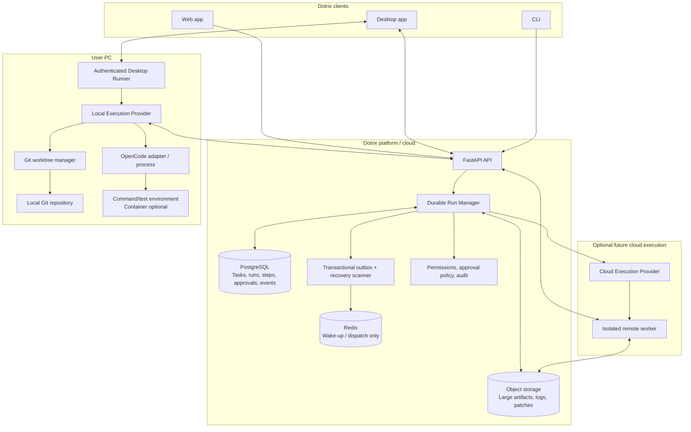
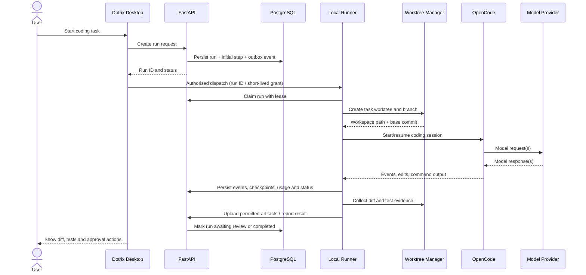
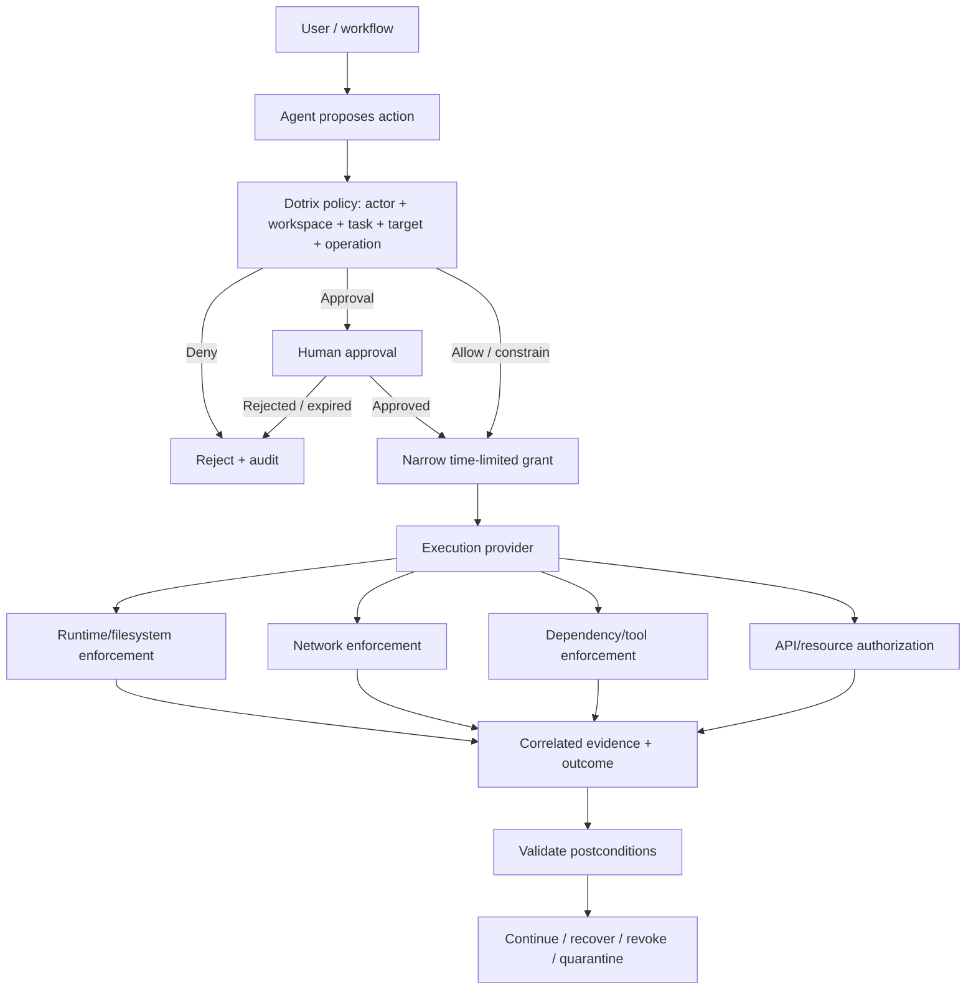

# Dotrix Hybrid Execution Architecture
## Cloud-Managed Tasks, Local-First Coding, and Optional Cloud Runners

- **Status:** Proposed architecture
- **Audience:** Dotrix engineering and product
- **Scope:** Follow-up to the durable agent harness design
- **Primary decision:** Keep Dotrix's project/task/run records in durable platform storage, while executing coding work locally on the user's desktop by default. Add cloud execution as an optional provider without changing the orchestration model.

---

## 1. Executive decision

Dotrix should separate **coordination and durable state** from **code execution**.

- **Cloud/platform layer:** canonical tasks, issues, comments, decisions, run state, approvals, event history, usage records, and durable artifacts.
- **Conversation and specialist layer:** DeepAgents on LangGraph powers Discuss, Plan, and specialist workflows within the same thread used for Build and Review. Dotrix's platform owns authorization and parent/child run state; the parent reconciles specialist findings and owns the user-facing response.
- **Desktop/local layer:** local repository access, OpenCode process lifecycle, Git worktree creation, command execution, test runs, and collection of code changes.
- **Optional cloud execution layer:** isolated remote workers for unattended runs, web-only users, or workloads that benefit from remote parallelism.
- **Shared orchestration:** the Dotrix run manager owns policy, run state transitions, retries, approvals, and parent/child agent orchestration. OpenCode is a replaceable coding runtime, not the platform-level orchestrator.

This design reduces the need to pay for cloud CPU/RAM for every coding task. It does **not** eliminate hosted-model API costs: model usage remains a separate cost centre.

Preserve the [product experience and principles](./dotrix-durable-agent-harness.md#2-product-experience-and-principles) across execution providers. Implementation starts from clear execution intent under the applicable authorization policy. The [Repository Knowledge skill](./dotrix-repository-knowledge-skill.md) runs as a durable specialist workflow and supplies compatible context to DeepAgents and OpenCode. Prove one recoverable local coding run before expanding concurrency.

## 2. Goals and non-goals

### Goals

1. Make local execution the default for desktop users with a local repository.
2. Preserve cloud-backed task visibility and history across desktop, web, and CLI.
3. Make runs recoverable after app crashes, network loss, or machine restarts.
4. Support one isolated Git worktree per independent coding task.
5. Keep local and cloud execution behind the same provider contract.
6. Make approvals, audit history, and permissions consistent across providers.
7. Minimise cloud compute and avoid unnecessary repository uploads.
8. Support a future cloud runner without redesigning the durable run manager.

### Non-goals for the first release

- Running local coding jobs while the PC is powered off.
- Building a general-purpose remote desktop or full VM platform.
- Treating Git worktrees as security sandboxes.
- Automatically merging or pushing agent changes without explicit policy and approval.
- Replacing OpenCode's coding capabilities with a new coding runtime.
- Making every user message invoke every specialist agent.

## 3. Architecture



### Key boundary

The cloud service cannot directly read a repository on the user's PC. The desktop runner must execute locally and send authorised status/events/results to the platform. The desktop app may bundle the runner or launch it as a separate local service. A separate process is preferable for lifecycle management and for limiting the privileges of the UI process.

## 4. Responsibility boundaries

| Responsibility | Owner | Notes |
|---|---|---|
| Tasks, issues, comments, decisions | Platform API + PostgreSQL | Canonical cross-device records |
| Run/step state and checkpoints | Durable Run Manager + PostgreSQL | Source of truth for workflow state |
| Dispatch intent | Transactional outbox | Prevents lost dispatches after DB commit |
| Wake-up/short-lived queue | Redis | Not the sole record of work |
| Local repository access | Desktop runner | Explicit per-project access |
| Worktree creation and cleanup | Local execution provider | Never remove uncommitted work blindly |
| Coding process | OpenCode adapter | Replaceable behind a stable interface |
| Shell commands and tests | Local execution environment | Apply least privilege; container isolation where appropriate |
| Cloud worker lifecycle | Cloud provider (future) | Separate compute lifecycle from workflow state |
| Approvals and policy | Dotrix platform | Same policy for local and cloud execution |
| Merge/push | User or approved platform workflow | Human approval by default |
| Large logs, patches, artifacts | Object storage | Metadata and references stored in PostgreSQL |
| LLM calls and token accounting | Runtime/provider instrumentation | Distinct from execution compute costs |

## 5. Local-first task lifecycle



### Detailed flow

1. The user starts a task from the desktop, web, or CLI.
2. The platform authenticates the user, checks workspace permissions, and creates a durable run record.
3. A transaction stores the run state and an outbox event together.
4. If local execution is selected, the platform dispatches the run to an authorised desktop runner. A runner must be online to accept it.
5. The runner verifies the grant, project binding, allowed operations, and run lease.
6. The runner creates a dedicated worktree and records the repository identity, base commit, branch, and workspace path.
7. The OpenCode adapter starts or resumes a coding session with a bounded task context.
8. The runner streams progress and periodically persists durable checkpoints and usage data.
9. The runner collects a diff, test results, and relevant artifacts. Large content is uploaded to object storage; the database stores metadata and references.
10. Dotrix presents a review summary. Push, merge, issue closure, and other protected actions follow platform approval policy.
11. The run is marked complete only after the final state and required artifacts have been durably recorded.

## 6. Git worktrees: use them for workspace isolation, not security

Git worktrees are a cost-effective way to avoid a full clone for every task and to let independent tasks work in separate directories.

Recommended naming pattern:

```text
<repo-root>/
  .git/                         # shared Git metadata
  ...existing working tree...

<dotrix-managed-workspace>/
  <project-id>/
    <run-id>/
      checkout/                 # dedicated worktree
      artifacts/
      runner-state.json         # non-secret recovery metadata
```

The actual workspace location should be configurable and should not require writing Dotrix metadata into the user's repository. Dotrix's own project metadata remains platform-side; do not place a `.dotrix/` control directory inside the user's code repository unless a deliberate product decision changes that invariant.

### Worktree rules

- One worktree and branch per independently executing coding task.
- Never allow two active agents to edit the same worktree concurrently.
- Record the base commit and branch before execution.
- Detect pre-existing user changes before creating or cleaning a workspace.
- Do not automatically discard dirty worktrees.
- Reconcile branch changes before retries; do not assume a retry starts from the original base.
- Keep the worktree manager idempotent so a crash during setup can safely resume.
- Clean up only after the user has accepted/discarded the result or a clear retention policy applies.
- Keep credentials, provider keys, SSH keys, and other secrets outside agent-readable repository files.

### Worktree versus sandbox

A worktree separates working directories and Git branches; it does **not** restrict operating-system access. For command isolation, use a container or other suitable OS-level isolation where available. Avoid exposing the user's home directory, host credentials, privileged devices, or the Docker socket to an agent container. A container is also not automatically secure if configured with excessive mounts or privileges.

For the first version, make isolation configurable and visible to the user. Never imply that a plain worktree is a security boundary.

## 7. Execution provider contract

Keep provider-specific process details out of the durable run manager.

Conceptual Python interface:

```python
from typing import Protocol


class ExecutionProvider(Protocol):
    async def submit(self, run_id: str) -> None: ...
    async def get_status(self, run_id: str) -> dict: ...
    async def cancel(self, run_id: str) -> None: ...
    async def collect_results(self, run_id: str) -> dict: ...
```

The production contract will likely also need methods or capabilities for:

- `health()` and runner capability discovery.
- `claim()` / lease renewal.
- `stream_events()` with a durable cursor.
- `resume()` or `reconcile()` after a restart.
- `request_approval()` for actions that require a user decision.
- `cleanup()` with safety checks.
- Cancellation acknowledgement and termination status.
- Provider-specific workspace and session metadata.
- Artifact manifests and usage reports.

Keep the contract narrow at first. Do not force cloud-specific fields into the core run model. Use provider capability declarations for features such as containers, network restrictions, parallelism, and persistence.

### Provider implementations

**LocalExecutionProvider**
- Runs through the desktop runner.
- Uses local repository paths and worktrees.
- Requires an online, authorised desktop.
- Persists state to the platform and may keep a small local recovery journal for offline periods.

**CloudExecutionProvider (later)**
- Uses an isolated remote worker.
- Uses a remote checkout or controlled source snapshot.
- Can continue when the user's PC is offline.
- Must follow the same run state, approval, artifact, and audit contracts.

## 8. Durable state and recovery

PostgreSQL remains the source of truth. Redis is only a dispatch/wake-up mechanism. A process being alive is not proof that a run is healthy.

Persist at least:

- `agent_runs`: parent run, requester, workspace, status, selected provider, timestamps, cancellation state.
- `run_steps`: named step, status, attempts, input/output references, idempotency key.
- `run_events`: append-only events with monotonically increasing sequence or durable cursor.
- `run_checkpoints`: resumable state references, step boundaries, runtime/session identifiers.
- `run_approvals`: requested action, policy reason, requester, decision, timestamp.
- `outbox_jobs`: durable dispatch intent, attempts, next-attempt time.
- `workspace_sessions`: provider, runner identity, repository identity, base commit, branch, worktree path reference, runtime/session identifiers, lease and last heartbeat.
- `run_artifacts`: artifact type, object-storage key, digest, size, retention and access metadata.
- `run_usage`: model/provider, input/output/cached tokens where available, cost estimate, retries and attribution.

Store sensitive values only in a secure secret store or OS credential facility, not in run events or logs.

### Leases and fencing

- A runner claims a run with a time-limited lease.
- The runner renews the lease while active.
- Each successful claim increments a fencing token or generation.
- Writes from an old runner generation are rejected after a newer generation takes ownership.
- Heartbeats indicate liveness but do not replace persisted state.
- A recovery scanner identifies expired leases and classifies the run before retrying.

### Recovery behaviour

| Failure | Required behaviour |
|---|---|
| Desktop UI closes, runner remains active | Runner continues if product lifecycle permits; UI reconnects and replays events |
| Runner crashes | Lease expires; recovery inspects the workspace and runtime before resuming |
| PC restarts | Runner discovers incomplete local sessions and reconciles with cloud state |
| Network disconnects | Runner journals bounded events locally, then syncs them with idempotency keys |
| Redis loses a message | Outbox/recovery scanner re-dispatches from durable database state |
| Model request times out | Classify whether the request may have completed; avoid blind duplicate execution |
| Upload succeeds but DB update fails | Retry idempotently and reconcile artifact metadata |
| Cancellation arrives | Persist intent, stop safely, record final process status, preserve changes |
| Worktree is dirty during cleanup | Keep it and ask for user action rather than deleting changes |

A local process cannot continue while the PC is powered off. Durability means the system can recover and resume when execution becomes available; it does not mean local compute is always running.

## 9. Desktop runner security

The runner is a privileged boundary and should not blindly execute commands received over the network.

Minimum requirements:

1. Authenticate the user and device; revoke access when the device is unlinked.
2. Use short-lived, scoped run grants rather than long-lived bearer tokens embedded in task data.
3. Bind each grant to workspace, project, repository, run, and permitted operation scope.
4. Validate every incoming run against current platform permissions.
5. Require explicit approval for risky or protected operations according to Dotrix policy.
6. Do not expose arbitrary local paths; maintain a user-approved repository registry.
7. Use least privilege for subprocesses and container mounts.
8. Keep secrets out of prompts, logs, artifacts, and source control.
9. Treat repository files, issue descriptions, retrieved documents, and tool output as untrusted data—not higher-priority instructions.
10. Record an audit event for command execution, approvals, cancellation, artifact upload, and Git operations.
11. Limit network access and filesystem access where practical.
12. Ensure the local API/service is not exposed to the public network without strong authentication and transport security.

Default policy should remain manual approval for consequential coding actions. Local execution must not silently bypass the platform's approval and workspace-permission rules.


### 9.1 Shared Agent Baseline model

Local and cloud execution must implement the same **policy intent**, even when the enforcement mechanism differs. Dotrix follows the rule: **the agent proposes; policy authorizes; infrastructure enforces; the platform records evidence.** Prompts, tool descriptions, agent-editable configuration and worktrees do not enforce security.

| Boundary | Local runner | Cloud worker |
|---|---|---|
| Sandbox/runtime | Dedicated unprivileged runner; approved repository/worktree paths; OS/container sandbox where supported; resource/time limits | Isolated worker/container; restricted mounts; resource/time limits; no unnecessary host privileges |
| Network/operations | OS/firewall/proxy/sandbox egress controls where available; block sensitive/internal targets | Worker/network-policy egress controls; restricted service access; block metadata/control-plane targets |
| Supply chain | Managed runtime/tool inventory; approved package sources; policy for risky installs/downloads | Pinned worker image/runtime; trusted registries; dependency/tool admission |
| Identity/access | Registered device + short-lived run grants bound to user/workspace/task/repo/operation | Scoped workload identity + short-lived grants bound to the same logical scope |

If a provider cannot enforce a security capability required by the selected execution profile, Dotrix should route to a suitable provider or refuse that execution mode. It must not represent a prompt-level restriction as equivalent enforcement.

### 9.2 Autonomy and delegation

Human-orchestrated, workflow-orchestrated and agent-orchestrated runs use the same security boundaries. More autonomy means the agent may choose more of the next permitted steps; it does **not** receive more permissions. Parent agents cannot delegate authority they do not possess, and child agents receive only task-specific scope.

### 9.3 Enforcement flow



### 9.4 Six security outcomes

- **Discover:** inventory registered runners/workers, providers, runtime/tool versions, dependency sources, owners and active grants.
- **Constrain:** limit filesystem, process, resources, network, credentials and data access.
- **Authorize:** evaluate trusted identity, task, target and operation; revalidate sensitive actions at execution time.
- **Observe:** correlate intent → identity → task/run → policy/approval → command/tool action → artifact/outcome.
- **Validate:** verify the selected provider actually supplied the required security profile and that tests/postconditions succeeded.
- **Respond:** cancel, revoke, terminate, disable a provider, quarantine artifacts and preserve evidence.

### 9.5 Recovery and revocation

A recovered run must not blindly reuse old authority. Revalidate relevant workspace permissions, scoped grants, approval expiry and execution profile before protected work resumes. Cancellation/revocation must reach the actual local process or cloud worker, stop new scheduling, fence stale attempts from protected writes, and record whether termination succeeded.

A local machine may be offline when revocation occurs. The platform should mark the grant revoked immediately; the runner must revalidate before protected actions after reconnect. Any actions that occurred while offline must be reconciled against durable state and policy.

### 9.6 Evidence without chain-of-thought

Persist operational evidence such as policy decisions, approval scope, commands/tools, dependency changes, diffs, tests, artifacts, recovery/cancellation events and outcomes. Correlate `workspace_id`, initiating identity, `task_id`, `run_id`, `attempt_id`, `agent_id`, `provider_id`, `policy_decision_id`, `approval_id`, `action_id` and artifact references where applicable. Do not expose private model reasoning as an audit mechanism.

## 10. Connectivity and event delivery

Use the existing authenticated platform connection where possible; avoid inventing a second unauthenticated channel from the cloud to the desktop.

Recommended behaviour:

- Desktop runner establishes an outbound authenticated connection.
- The platform dispatches only to a registered, online runner with matching capabilities.
- Each event has a run ID, event ID/sequence, timestamp, type, and idempotency key.
- The UI can replay events after a cursor and recover after reconnect.
- Duplicate events are safe to ignore.
- The runner batches non-critical telemetry when disconnected, but critical state transitions are persisted before being reported as complete.
- Large logs and diffs are uploaded as artifacts rather than repeatedly embedded in event payloads.
- Event streams are a view of durable state, not the source of truth.

## 11. Cost model

Local-first execution reduces cloud compute, not all costs.

| Cost category | Local-first impact |
|---|---|
| Cloud CPU/RAM for coding workers | Substantially reduced for local jobs |
| Cloud database and API | Still required for shared task/run state |
| Object storage and egress | Depends on artifact size and upload policy |
| Hosted LLM inference | Still charged by the model provider when used |
| Local CPU/RAM/disk | Paid by the user's device |
| Cloud execution | Incurred only for tasks routed to remote workers |
| Operational complexity | Increased by runner lifecycle, local recovery, and support |

Cost controls:
- Do not upload whole repositories by default.
- Upload only needed artifacts, diffs, test reports, and selected logs.
- Use context selection and persist completed specialist results to avoid rerunning them unnecessarily.
- Avoid launching every specialist for every user message.
- Track model tokens/cost separately from execution compute.
- Allow users to select local, cloud, or automatic routing when the cloud provider exists.
- Put quotas and concurrency limits on remote execution.

## 12. Recommended implementation plan

### Phase 1 — Confirm existing architecture
- [ ] Review current run, step, checkpoint, event, approval, artifact, and coding-session models.
- [ ] Map existing OpenCode integration and session lifecycle.
- [ ] Identify whether a desktop-side process can run independently of the UI.
- [ ] Document current authentication and device registration mechanisms.
- [ ] Confirm current workspace scoping and audit invariants.
- [ ] Avoid creating duplicate tables or abstractions where existing models already satisfy the requirements.

**Exit criteria:** A short gap analysis maps existing components to this design and lists only the missing pieces.

### Phase 2 — Define the execution-provider boundary
- [ ] Add a provider contract and capability model.
- [ ] Keep provider-specific logic out of the parent run manager.
- [ ] Implement provider selection in run metadata.
- [ ] Add a mock provider for deterministic tests.
- [ ] Define standard status, cancellation, event, result, and error types.
- [ ] Ensure all provider actions receive the run ID and an authorised scoped context.

**Exit criteria:** The same run-manager tests pass against a mock provider without OpenCode or a real repository.

### Phase 3 — Build the local runner
- [ ] Create a runner lifecycle independent of the desktop renderer/UI.
- [ ] Add device registration, revocation, health reporting, and capability discovery.
- [ ] Add a secure dispatch protocol with short-lived scoped grants.
- [ ] Register user-approved local repositories.
- [ ] Implement idempotent worktree creation and branch naming.
- [ ] Capture repository identity, base commit, branch, and workspace metadata.
- [ ] Start OpenCode through the existing adapter.
- [ ] Stream status and bounded events to the platform.
- [ ] Implement safe cancellation and process termination.
- [ ] Preserve dirty worktrees and uncommitted changes.

**Exit criteria:** A user can start, monitor, cancel, and review one local coding task from Dotrix.

### Phase 4 — Make local execution recoverable
- [ ] Persist state transitions before acknowledging them.
- [ ] Add leases, heartbeat expiry, and fencing tokens.
- [ ] Add a small local recovery journal for bounded offline events.
- [ ] Reconcile local runtime sessions with cloud run records after restart.
- [ ] Add idempotency keys for events, artifact uploads, and step completions.
- [ ] Implement a recovery scanner for expired leases and interrupted runs.
- [ ] Distinguish safe-to-retry steps from ambiguous side effects.
- [ ] Add event replay from a durable cursor.
- [ ] Verify recovery does not duplicate completed model/tool actions blindly.

**Exit criteria:** Killing the runner or restarting the PC does not lose the canonical run record or silently discard the workspace.

### Phase 5 — Review and safety controls
- [ ] Show changed files, diff, tests, errors, and relevant artifacts.
- [ ] Require approval for protected operations.
- [ ] Validate workspace permissions on every dispatch and protected action.
- [ ] Prevent secret leakage through logs and artifacts.
- [ ] Add container isolation options and document limitations.
- [ ] Add safe cleanup and retention controls.
- [ ] Test malicious repository instructions and untrusted tool output.
- [ ] Add audit events for command execution and Git actions.

**Exit criteria:** A task cannot bypass Dotrix policy merely because it runs on the user's machine.

### Phase 6 — Cost and product polish
- [ ] Show execution location and runner connectivity.
- [ ] Explain when a task needs the desktop online.
- [ ] Show LLM usage separately from local/cloud compute.
- [ ] Add concurrency limits and local resource checks.
- [ ] Add diagnostics for runner installation and permissions.
- [ ] Add clear recovery UI for offline, stale, interrupted, and conflicted runs.
- [ ] Add local workspace retention and disk-space warnings.

**Exit criteria:** Users understand where code runs, what costs may apply, and how to recover interrupted work.

### Phase 7 — Optional cloud provider
- [ ] Reuse the same provider contract and run lifecycle.
- [ ] Provision isolated workers with resource/time limits.
- [ ] Define repository checkout/source transfer and artifact policies.
- [ ] Apply the same approval, audit, and workspace-permission rules.
- [ ] Add cloud-only routing for unattended and web-only tasks.
- [ ] Measure cost per run and enforce budgets.
- [ ] Test worker loss and remote artifact reconciliation.

**Exit criteria:** A task can be routed to cloud execution without changing task semantics or bypassing policy.

## 13. Test and acceptance checklist

- [ ] Two independent tasks create separate worktrees and do not overwrite each other.
- [ ] A task cannot start on an unregistered or revoked runner.
- [ ] An expired run lease is detected and reconciled.
- [ ] Duplicate dispatches do not create duplicate active worktrees for the same run.
- [ ] A runner restart preserves the diff and task history.
- [ ] A network outage followed by reconnection does not create duplicate events.
- [ ] A cancelled task preserves work and reports the actual process state.
- [ ] A dirty worktree is not automatically deleted.
- [ ] The desktop cannot read repositories outside the approved registry.
- [ ] A malicious task/repository instruction cannot override platform policy.
- [ ] Protected Git operations require approval.
- [ ] Model usage is attributed to the correct parent and child runs.
- [ ] A cloud run and a local run produce the same standard result shape.
- [ ] The UI can replay activity after a reconnect using a durable cursor.
- [ ] Redis restart does not lose the only copy of a pending dispatch.
- [ ] Cross-workspace resource access is denied at the API and execution boundary.
- [ ] A child agent cannot expand its delegated authority.
- [ ] A denied network/package operation cannot succeed through an alternate tool path.
- [ ] Expired/revoked grants cannot authorize new protected operations.
- [ ] Recovery revalidates authorization before protected work continues.
- [ ] Provider capability mismatch rejects or reroutes a run instead of silently weakening security.
- [ ] Audit evidence correlates actor, task, run, policy decision, approval, action and outcome without storing secrets or private chain-of-thought.

## 14. Key decisions to preserve

1. **PostgreSQL is the source of truth** for tasks, runs, steps, approvals, and event metadata.
2. **Redis is not durable workflow state.** Use an outbox and recovery scanner.
3. **The desktop runner executes local work.** The cloud cannot directly access local repository files.
4. **Git worktrees are workspace isolation, not security isolation.**
5. **OpenCode is the coding runtime.** Dotrix owns orchestration, policy, and durable state.
6. **Local execution is the desktop default; cloud execution is optional.**
7. **LLM cost and execution compute cost are different.**
8. **Human approval remains required for consequential operations.**
9. **A powered-off PC cannot execute local work.** The run can recover when the runner returns.
10. **Inspect and extend existing Dotrix abstractions before adding new ones.**
11. **Agents propose; policy authorizes; infrastructure enforces.** Prompts are not security boundaries.
12. **More autonomy does not mean more permission.** Delegation cannot expand authority.
13. **Local and cloud execution share the same policy intent** across runtime, network, supply-chain and identity/access boundaries.

## 15. References

- Vercel, “Making every harness durable”: https://vercel.com/blog/making-every-harness-durable
- OpenCode documentation: https://opencode.ai/docs/
- OpenCode SDK documentation: https://opencode.ai/docs/sdk/
- Git worktrees: https://git-scm.com/docs/git-worktree
- Agent Baseline, “The Secure Software Factory: A Reference Architecture”: https://agentbaseline.org/reference-architecture
- Agent Baseline: https://agentbaseline.org/

---

**Recommended first vertical slice:** implement one recoverable local OpenCode run from the Dotrix desktop, backed by the existing durable run manager. Do not begin with distributed multi-agent execution or a cloud worker fleet. Prove local dispatch, worktree safety, persisted progress, restart recovery, and human review first.
